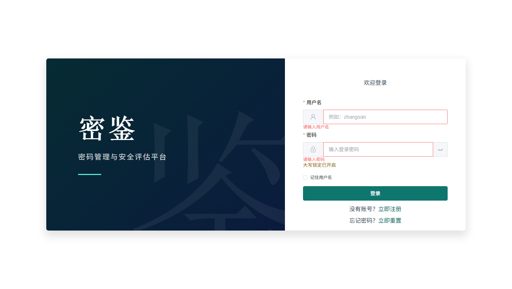
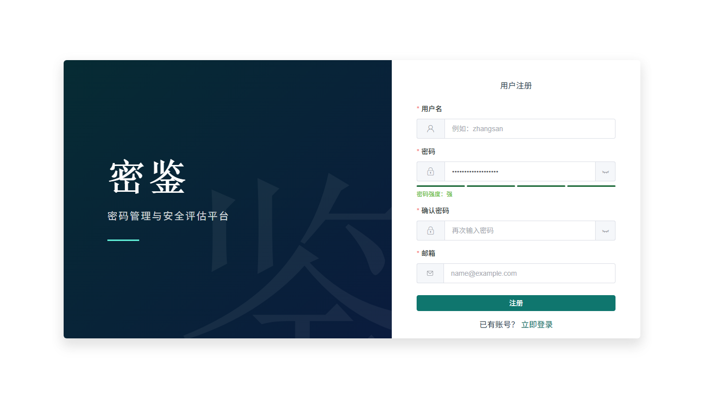
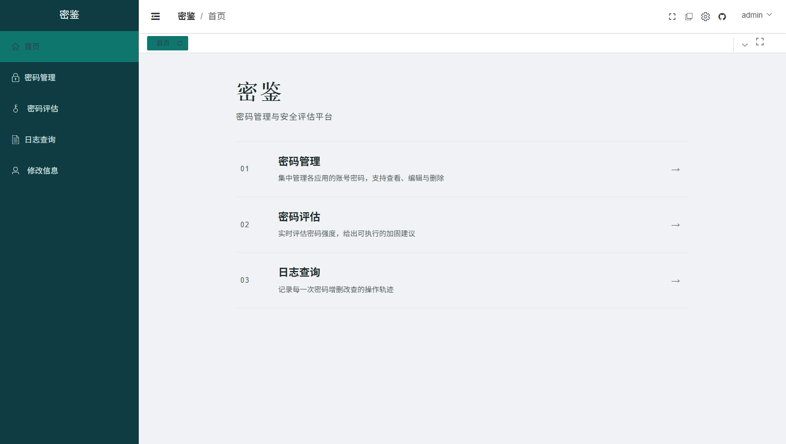
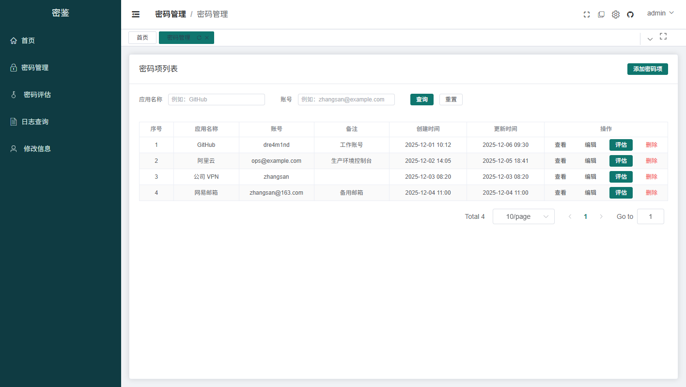
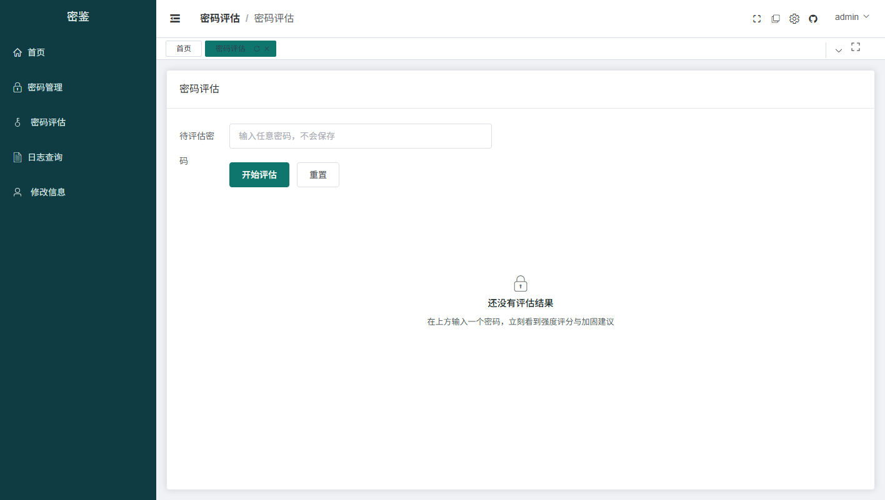
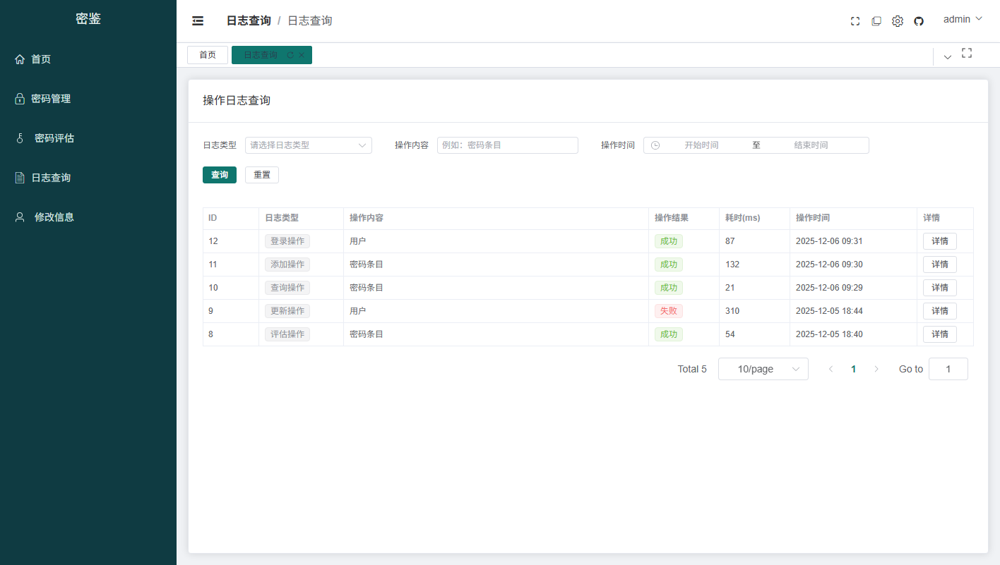

# 密鉴 CipherLens（密码管理与安全评估平台）

前后端分离项目，前后端各自独立构建、独立部署，通过 HTTP 接口通信。

## 界面

| 登录 | 注册（含密码强度提示） |
| --- | --- |
|  |  |

| 首页 | 密码管理 |
| --- | --- |
|  |  |

| 密码评估 | 日志查询 |
| --- | --- |
|  |  |

> 截图为 1440×760 的真实运行截图。

## 功能

**账号与认证**

- 注册、登录、邮箱验证码找回密码
- 登录页可记住用户名（只存用户名，不存密码，默认不勾选）
- 密码框大写锁定提示；注册与重置密码时实时显示密码强度
- 表单错误就地提示，校验失败自动定位到第一个出错字段，提交中禁止重复点击

**密码管理**

- 密码项增删改查，支持按应用名称、账号检索与分页
- 内置随机密码生成器：可选长度（8–64）、字符集、排除易混字符（0 O 1 l I），带强度提示与一键复制
- 多选后批量评估、批量删除、导出 CSV（导出内容不含明文密码）
- 查看明文需经 KMS 解密（未配置 KMS 时该功能不可用）
- 删除前二次确认

**密码评估**

- 输入任意密码即时给出评分、风险类型与加固建议
- 结果区附仪表盘总分与五维雷达图（长度、大小写、数字、符号、无规律）

**日志审计**

- 记录登录、增删改查、评估等操作，可按类型、内容、时间范围筛选并查看详情

**用户信息**

- 修改用户名与密码

## 目录结构

```
cipherlens/
├── docker-compose.yml    # 一键编排：MySQL + Redis + 后端 + 前端(Nginx)
├── .env.example         # 环境变量模板
├── .gitignore
├── frontend/            # 前端：Vue 3 + Vite 2 + Element Plus + WindiCSS
│   ├── src/
│   ├── Dockerfile       # 多阶段构建：node 构建 → nginx 托管
│   ├── nginx.conf       # SPA 兜底 + /api 反代到后端
│   ├── .env.development # 开发环境配置（代理到 http://localhost:8080）
│   ├── .env.production  # 生产环境配置（接口前缀 /api，由 Nginx 反代）
│   └── vite.config.js
├── docs/screenshots/    # README 用的真实运行截图
├── backend/             # 后端：Spring Boot 3.5 + MyBatis-Plus + MySQL + Redis
│   ├── src/main/java/com/dre4m1nd/cipherlens/
│   ├── src/main/resources/application.yml
│   ├── src/main/resources/application-dev.yml
│   ├── src/main/resources/application-prod.yml   # 容器用，读取环境变量
│   ├── sql/
│   │   ├── init.sql           # 建表 + 弱密码种子（首次启动 MySQL 自动执行）
│   │   └── rename-database.sql # 旧库 pme_system → cipherlens 迁移
│   ├── pom.xml
│   └── Dockerfile        # 多阶段构建：maven 打包 → jre 运行
└── README.md
```

> 本项目为单一 Git 仓库（原 `frontend/`、`backend/` 各自的历史已通过 `git bundle` 备份在仓库根目录外）。

## 命名

| 项目 | 取值 |
| --- | --- |
| 中文名 / 英文名 | 密鉴 / CipherLens |
| 根目录、Maven `artifactId`、jar 包 | `cipherlens` |
| Java 包名 | `com.dre4m1nd.cipherlens` |
| 启动类 | `CipherLensApplication` |
| 日志文件 | `/app/logs/cipherlens-yyyy-MM-dd.i.log` |
| 数据库名 | `cipherlens`（由 `pme_system` 迁来，见下方迁移） |
| Redis Token 盐值 | `cipherlens-salt-2025`（旧 token 失效，需重新登录） |

## 开发环境启动

### 后端（端口 8080）

依赖：JDK 21、Maven、MySQL（库名 `cipherlens`）、Redis（localhost:6379）。

已有旧库 `pme_system` 时，先执行改名脚本（会逐表 RENAME，不复制数据）：

```bash
mysqldump -uroot -p --databases pme_system --routines --triggers > pme_system.bak.sql
mysql -uroot -p < backend/sql/rename-database.sql
```

```bash
cd backend
mvn spring-boot:run
```

数据库与 Redis 连接在 `src/main/resources/application-dev.yml` 中配置；
华为云 KMS（`huawei.kms.key-id/region`）、RSA 公钥（`crypto.rsa.public-key`）也在该文件，
本地未配置 KMS AK/SK 时仅“注册 / 查看密码明文”不可用；找回密码验证码默认打印到后端日志（`security.reset.code-log-enabled: true`）。

### 前端（端口 3001）

依赖：Node.js 16+。

```bash
cd frontend
npm install
npm run dev
```

前端请求统一走 `/api` 前缀（`src/utils/system/request.js` 中 `baseURL = '/api'`），
开发环境由 Vite 代理转发到后端并去掉 `/api` 前缀：

```
/api/user/login  →  http://localhost:8080/user/login
```

## 生产构建

```bash
# 前端：产物在 frontend/dist
cd frontend && npm run build

# 后端：产物在 backend/target/cipherlens-0.0.1-SNAPSHOT.jar
cd backend && mvn clean package -DskipTests
```

## Docker 一键部署

使用 Docker Compose 编排 MySQL 8 + Redis 7 + 后端 + 前端（Nginx 托管 `dist` 并反代 `/api`）。

```bash
# 1. 复制环境变量模板（必须：MYSQL_ROOT_PASSWORD 与 TOKEN_SECRET_KEY 留空时 compose 会直接报错）
cp .env.example .env
# 编辑 .env，至少填写 MYSQL_ROOT_PASSWORD、TOKEN_SECRET_KEY（openssl rand -base64 32）

# 2. 构建并启动（首次会下载镜像、编译后端、打包前端，请耐心等待）
docker compose up -d --build

# 3. 查看日志
docker compose logs -f backend
```

启动后访问 http://localhost （前端），后端接口在 http://localhost:8080 ，接口文档需设 `API_DOCS_ENABLED=true` 才暴露。

### 关键约定

- **数据库**：`backend/sql/init.sql` 在 MySQL 卷为空时自动建库建表并写入弱密码种子；它只跑一次（删 `mysql-data` 卷可重置）。
- **接口前缀**：前端请求走 `/api`，Nginx 在 `frontend/nginx.conf` 中去掉 `/api` 前缀转发到 `backend:8080`（后端无 context-path）。
- **生产配置**：后端以 `prod` 环境启动，数据库连接、Redis、Token 密钥、华为云 KMS、RSA 公钥、邮件服务均通过环境变量注入（见 `application-prod.yml` 与 `.env.example`）。
- **健康检查**：后端暴露 `/actuator/health`（仅 health，无详情），已加入 Docker 健康检查；前端 `depends_on` 后端 healthy 后才启动，避免启动期 502。
- **Token 秘钥**：`TOKEN_SECRET_KEY` 必填且至少 16 位，后端启动时会校验；`MYSQL_ROOT_PASSWORD` 同样为必填，不再提供弱默认值。
- **华为云 KMS**：`HUAWEI_AK` / `HUAWEI_SK` 仅在使用 KMS 解密类功能时需要；`HUAWEI_KMS_KEY_ID` 与 `RSA_PUBLIC_KEY` 必须成对（同一密钥对），换密钥只需改环境变量，无需改代码。
- **密码找回**：`POST /user/reset/code` 发送邮箱验证码（Redis 存 5 分钟、60 秒冷却、最多 5 次校验），`POST /user/reset` 需带 `code`；重置成功后旧 token 立即失效。需要配置 `MAIL_HOST` / `MAIL_PORT` / `MAIL_USERNAME` / `MAIL_PASSWORD`，未配置时该接口返回明确提示；仅本地可用 `RESET_CODE_LOG_ENABLED=true` 把验证码打到日志。
